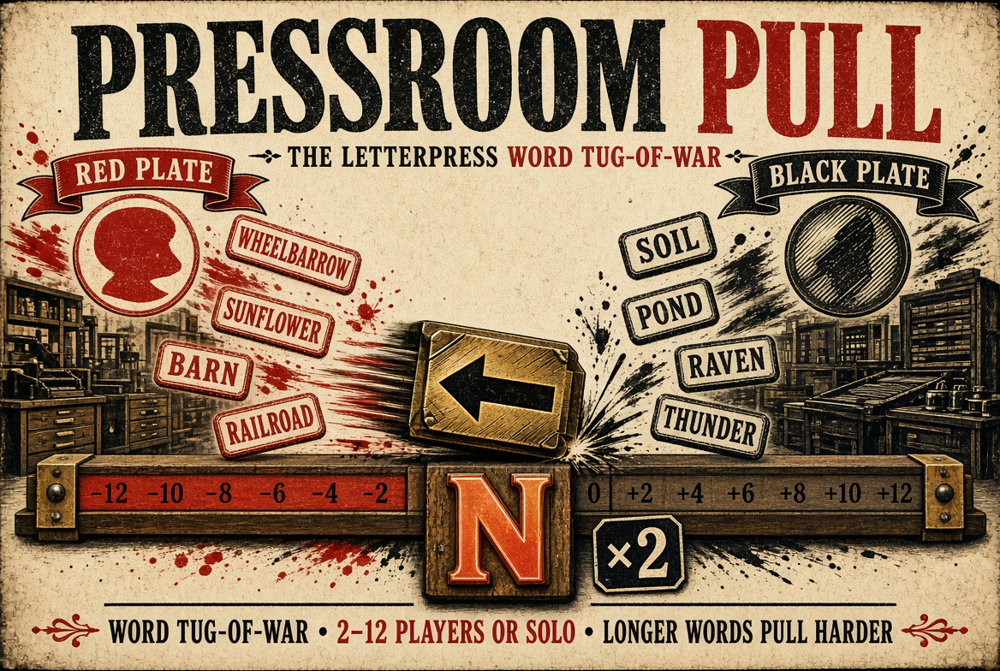

# Pressroom Pull



**Play now:** https://pressroom-pull.onrender.com/ (enter a name and tap **Practice alone** to pull against a bot printer)

A real-time letterpress word tug-of-war for 2–12 players. The Node server owns each room, accepted word list, slug position, set timer and score. Players connect by four-letter shop code; no account is needed.

## Run locally

Requires Node.js 18 or newer. The server uses Node's built-in HTTP and WebSocket support; there are no packages to install.

```sh
npm start
```

Open `http://localhost:3000` and use another browser or device on the same network to join the room. For other devices on the network, use the host computer's local IP address in place of `localhost`. A public deployment needs a Node host that supports WebSockets and a public HTTPS URL.

## Game rules

- Two plates compete to pull the slug from zero to either edge, at −12 or +12.
- Words are 3–20 letters, must contain a vowel, cannot repeat four letters in a row, and can be used once per set.
- Three to four letters pull 1, five to seven pull 2, and eight or more pull 3. The Hot Letter doubles the pull, up to 6.
- Sets last 75 seconds. A tie at zero goes to 10-second sudden death, where the next word wins. Best of three sets wins.
- The Foreman can strike a word; its pull reverses and the word stays used.
- **The type case:** each plate sets words from a tray of metal letters, sized to its crew (one share per printer: plenty of E, A, O, I, T, N, S and R, one each of the rare sorts, and only two of the Hot Letter). Every word uses its letters; the type is distributed back into the case 10 seconds later. A word the case can't supply is refused as *out of sorts*. Struck words return their type at once. The tray sits under the composer and lights up the letters your word needs and the ones you're missing. The Gazette reports how often each plate ran out of sorts and how many rare sorts it spent.
- If a plate empties mid-set, the clock pauses for 20 seconds before that plate forfeits. A Foreman who refreshes keeps the role for 15 seconds.
- A short blocklist rejects profanity and slurs.

The validator uses the brief's lightweight vowel and repeated-letter checks. It does not query a dictionary, so the Foreman strike is the in-game correction tool.

- Gamified layer (`fx.js`): printer's ranks from Printer's Devil to Proprietor, XP and eight engraved medals saved on the device, word combos, ink and type-sort bursts and a shareable result card

Submission details (title, description, cover, link) are in [SUBMISSION.md](SUBMISSION.md).
